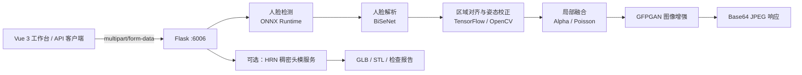

# AIHB 2 · 人脸部位替换与 3D 头模生成

<p align="center">
  <strong>面向本地 GPU 推理的人脸局部编辑工作台</strong>
</p>

<p align="center">
  <a href="#快速开始">快速开始</a> ·
  <a href="#功能一览">功能</a> ·
  <a href="#接口使用">API</a> ·
  <a href="#3d-头模">3D 头模</a> ·
  <a href="#开发与测试">测试</a>
</p>

<p align="center">
  
  
  
  
  
</p>

> AIHB 2 将目标人脸中的指定区域替换为来源人脸对应区域，并提供浏览器工作台、HTTP API 与可选的单图稠密人脸/打印头模生成能力。项目设计目标是 **Windows + NVIDIA GPU 的本地或可信局域网推理**。

## 功能一览

- **11 种可替换区域**：鼻子、眼睛、左右眼、眉毛、左右眉、嘴唇、上/下唇及口腔。
- **保留原有换鼻主链路**：人脸检测、语义分割、关键点驱动对齐、颜色校正、局部融合与 GFPGAN 增强。
- **侧鼻校正**：鼻子替换会根据姿态信息选择侧鼻到正脸的局部校正分支，并在响应中返回状态。
- **可视化工作台**：Vue 3 前端支持双图上传、处理进度、前后对比、下载与本地历史记录。
- **开放 HTTP API**：`multipart/form-data` 上传，返回可直接渲染的 Base64 JPEG；无需认证。
- **可选 3D 头模**：基于 HRN 的稠密人脸重建，将面部细节融合到固定封闭头模，导出 GLB、STL 与网格检查报告。

## 架构



## 快速开始

### 运行要求

| 项目 | 建议版本 | 说明 |
| --- | --- | --- |
| 操作系统 | Windows 10/11 64 位 | 当前默认部署方案 |
| Python | 3.10.x | 不建议使用 Python 3.12+ |
| Node.js | 18+ | 用于 Vue 前端构建 |
| NVIDIA GPU | CUDA 11.8 兼容 | 推荐；模型推理依赖 GPU 运行时 |
| Git / 网络 | 最新稳定版 | 首次安装依赖及按需下载缓存 |

项目根目录的 `pretrained_model/` 应包含主模型权重。完整清单、缓存迁移和离线部署说明请参阅 [DEPLOY_CODEBUDDY.md](DEPLOY_CODEBUDDY.md)。

### 1. 配置 Python 环境

在项目根目录打开 PowerShell：

```powershell
# 首次部署可直接双击 setup_env.bat。
# 手动安装时，务必使用 Python 3.10 虚拟环境：
.\.venv\Scripts\python.exe -m pip install `
  --extra-index-url https://download.pytorch.org/whl/cu118 `
  -r requirements.txt
```

`setup_env.bat` 会尝试创建环境、安装依赖并构建前端；需要可审计、可复现的换机流程时，请优先遵循部署文档的分步命令。

### 2. 启动后端

```powershell
.\.venv\Scripts\python.exe flask_server.py
```

服务默认监听 `http://127.0.0.1:6006`。也可双击 `start.bat` 同时启动后端和前端开发服务。

### 3. 启动前端

另开一个终端：

```powershell
Set-Location frontend
npm install
npm run dev
```

打开 `http://127.0.0.1:5173`。开发服务器会将 `/predict` 和 `/api` 代理到本地 Flask 服务。

### 4. 单端口运行（推荐演示/内网部署）

```powershell
Set-Location frontend
npm run build
Set-Location ..
.\.venv\Scripts\python.exe flask_server.py
```

然后访问 `http://127.0.0.1:6006/app/`。构建产物由 Flask 托管，前端与 API 同源。

## 克隆后还需准备

GitHub 仓库只包含源码和文档，不包含模型权重、个人照片或生成结果。安装 Python / npm 依赖并不能替代这些模型文件；缺少主权重时，后端无法完成真实推理。

### 2D 部位替换

请自行准备下列主模型，并放入项目根目录的 `pretrained_model/`（合计约 457 MB）：

| 文件 | 大小约 | 用途 |
| --- | ---: | --- |
| `FaceDetector.onnx` | 1.8 MB | 人脸检测 |
| `fp_512.pth` | 53.3 MB | BiSeNet 人脸解析与部位分割 |
| `rvm_resnet50_fp16.onnx` | 53.8 MB | 人脸/背景分割 |
| `GFPGANCleanv1-NoCE-C2.pth` | 348.6 MB | GFPGAN 人脸增强 |

`FaceLandmark.onnx` 和 `rvm_mobilenetv3_fp16.onnx` 是备用模型，当前主流程不直接使用。模型的来源、文件校验和部署缓存迁移说明见 [DEPLOY_CODEBUDDY.md](DEPLOY_CODEBUDDY.md)；请同时遵守各模型与数据资产的许可条款。

首次运行时，依赖还可能需要获取 ResNet18、facexlib parsing/detection 和 RealESRGAN 缓存。联网时库会按需下载；离线部署需另外预置这些缓存，路径和检查命令见部署文档。环境按 Windows 10/11、Python 3.10、兼容 CUDA 11.8 的 NVIDIA GPU 配置；前端开发或构建另需 Node.js 18+。2D 主流程不需要 WSL。

仓库不含人脸示例图片，前端接口示例画廊可能没有图片预览；这不影响上传两张自己的图片进行替换。若要重新生成画廊示例，需先准备 `images/` 中脚本要求的样例图片和全部推理模型，再运行 `tests/generate_api_examples.py`。

### 可选 3D 头模

除主项目依赖外，还需要 Ubuntu 22.04 WSL、NVIDIA GPU 和网络。运行 `setup_dense_head.ps1` 会下载 HRN 推理代码、权重及头模资产，并建立独立运行环境；详细步骤见 [head_reconstruction/DENSE_HEAD.md](head_reconstruction/DENSE_HEAD.md)。

七牛上传和喵提醒默认关闭。若需要启用，后端副本使用 `QINIU_ACCESS_KEY`、`QINIU_SECRET_KEY`、`QINIU_BUCKET_NAME`、`QINIU_CDN_DOMAIN` 和 `MIAOTIXING_ID` 环境变量；`FLASK_SECRET_KEY` 可用于设置稳定的会话密钥。仅本地推理时无需这些服务配置。

## 接口使用

### `POST /predict`

上传一张目标人脸和一张来源人脸，替换来源图中的指定部位到目标图。

| 字段 | 类型 | 必填 | 说明 |
| --- | --- | :---: | --- |
| `face_image` | file | 是 | 目标人脸图片 |
| `source_image` | file | 是 | 部位来源图片；兼容旧字段 `nose_image` |
| `region` | string | 否 | 默认 `nose`，可用值见下表 |

```bash
curl -X POST http://127.0.0.1:6006/predict \
  -F "face_image=@./target.jpg" \
  -F "source_image=@./source.jpg" \
  -F "region=nose"
```

成功响应示例：

```json
{
  "success": true,
  "error": null,
  "result": "<base64-encoded-jpeg>",
  "region": "nose",
  "nose_pose_corrected": false
}
```

`result` 不带 `data:` 前缀；在网页中预览时请拼接为 `data:image/jpeg;base64,<result>`。这是同步推理接口，客户端建议设置至少 300 秒超时，并始终检查 `success` 字段。

### 支持区域

| 参数 | 中文名称 | 参数 | 中文名称 |
| --- | --- | --- | --- |
| `nose` | 鼻子 | `eye` | 双眼 |
| `l_eye` | 左眼 | `r_eye` | 右眼 |
| `brow` | 双眉 | `l_brow` | 左眉 |
| `r_brow` | 右眉 | `lip` | 嘴唇 |
| `u_lip` | 上唇 | `l_lip` | 下唇 |
| `mouth` | 口腔 |  |  |

> 建议选择光照、视角、表情和清晰度相近的单人正脸照片。口腔和嘴唇要求两张图片的张嘴状态相近；大幅侧脸、强遮挡、多人或极低清晰度输入会被拒绝或导致自然度下降。

### 发现接口

```bash
curl http://127.0.0.1:6006/api/endpoints
```

该接口返回当前后端实际开放的区域、参数与响应说明，适合作为客户端动态配置来源。

## 3D 头模

AIHB 2 可选集成基于 HRN 的单图稠密面部重建。它使用固定的封闭头模，只融合面部区域的预测形状和细节，可导出：

- 用于预览的 GLB；
- 尺寸为 150–250 mm 的 STL；
- 网格与尺寸检查 JSON 报告。

首次配置需要已安装主项目环境、Ubuntu 22.04 WSL、NVIDIA GPU 和网络：

```powershell
.\setup_dense_head.ps1
.\start_head.bat
```

独立服务启动后访问 `http://127.0.0.1:6007/app/#/head`。稠密重建的安装过程、适用许可、API 及打印边界请完整阅读 [head_reconstruction/DENSE_HEAD.md](head_reconstruction/DENSE_HEAD.md)。这是单图估计和网格拓扑检查，**不等同于扫描精度或实际打印质量保证**。

## 项目结构

```text
AIHB2/
├── flask_server.py              # Flask 服务与 /predict 入口
├── warper.py                    # 部位替换主流程
├── region_adapter.py            # 各部位校验、融合与增强策略
├── nose_pose.py                 # 侧鼻姿态校正
├── aligner.py / blender.py      # 对齐与图像融合
├── api_catalog.py               # API 元数据
├── face_detector/               # ONNX 人脸检测
├── segmentation/                # 人脸/部位语义分割
├── super_resolution/            # GFPGAN + RealESRGAN 增强封装
├── head_reconstruction/         # HRN 稠密头模能力
├── pretrained_model/            # 主模型权重（本地提供）
├── frontend/                    # Vue 3 + Vite 工作台
├── tests/                       # 单元测试与端到端冒烟测试
├── DEPLOY_CODEBUDDY.md          # 迁移、部署与验收手册
└── 后续改进.md                   # 功能演进规划
```

## 开发与测试

运行常规单元测试：

```powershell
.\.venv\Scripts\python.exe -m unittest discover -s tests -v
```

运行真实模型的部位与侧鼻冒烟测试（会产生 `outputs/` 结果，耗时较长）：

```powershell
.\.venv\Scripts\python.exe tests\smoke_regions.py
.\.venv\Scripts\python.exe tests\smoke_regions.py --enhance
.\.venv\Scripts\python.exe tests\smoke_nose_pose.py
```

稠密头模验证需要独立环境：

```powershell
.\.venv-head\Scripts\python.exe -m unittest discover -s tests -p test_dense_head.py
.\.venv-head\Scripts\python.exe -m tools.hrn_setup.validate_runtime
```

前端修改完成后执行 `npm run build`，再通过 `/app/` 检查构建后的实际页面。请勿将 `.venv/`、`node_modules/`、`outputs/` 或生成结果提交到仓库。

## 模型与运行说明

- 主流程使用 RetinaFace ONNX 检测、人脸解析权重、RVM、GFPGAN 等本地文件；`pretrained_model/` 不完整时无法保证启动成功。
- 部分第三方增强依赖在首次运行时可能尝试下载缓存。网络受限环境请按部署文档预置权重与 wheel 缓存。
- PyTorch 与 ONNX Runtime 使用 CUDA 11.8 依赖组合；TensorFlow 仅承担轻量仿射优化，Windows 默认以 CPU 执行。
- 前端构建所需版本以 [frontend/package.json](frontend/package.json) 及锁文件为准。

## 隐私、安全与使用边界

- 人脸图片属于敏感个人信息。部署前请取得当事人授权，并遵循适用的隐私、肖像和生物识别信息法规。
- 本项目默认面向本机或可信局域网。不要将未鉴权的 Flask 开发服务器直接暴露到公网。
- 发布、镜像或交接代码前，应审查所有第三方服务配置、访问凭据和通知配置；使用环境变量或安全的密钥管理服务，且立即轮换任何曾进入工作副本的凭据。
- 七牛上传与喵提醒默认关闭；如需启用，请配置 `QINIU_ACCESS_KEY`、`QINIU_SECRET_KEY`、`QINIU_BUCKET_NAME`、`QINIU_CDN_DOMAIN` 和 `MIAOTIXING_ID` 环境变量。`FLASK_SECRET_KEY` 可用于设置稳定的会话密钥。
- 结果仅供创意、原型和研究用途。它不能用于身份核验、医疗判断、欺诈或任何会误导他人的场景。

## 文档导航

- [部署与换机验收](DEPLOY_CODEBUDDY.md)：模型缓存、环境重建、GPU 检查和本地部署验收。
- [稠密头模与打印说明](head_reconstruction/DENSE_HEAD.md)：HRN 环境、导出格式、拓扑检查和已知限制。
- [算法实验笔记](readme.ipynb)：原始换鼻算法推导与实验过程。
- [后续改进规划](后续改进.md)：从换鼻扩展到更多面部区域的设计记录。

## 贡献

欢迎以 Issue 或 Pull Request 形式提交问题、复现步骤和改进方案。提交前请：

1. 说明运行环境、GPU 型号、依赖版本及最小复现步骤；
2. 对后端修改运行相关测试，对前端修改完成生产构建；
3. 移除人脸原图、模型权重、生成结果、日志与任何凭据；
4. 避免在变更中无意升级核心推理依赖，以保证现有 CUDA 组合可复现。

## 许可证

当前仓库尚未提供统一开源许可证。除非获得权利人明确书面授权，请勿将代码、模型权重、示例图片或第三方资源用于分发或商业用途；第三方模型和资产还需分别遵守其自身许可条款。
